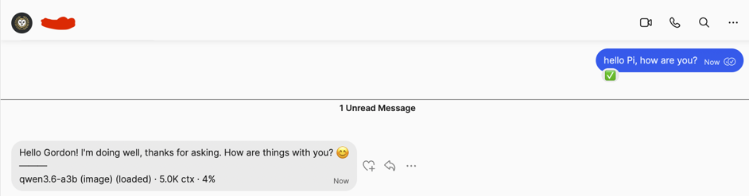
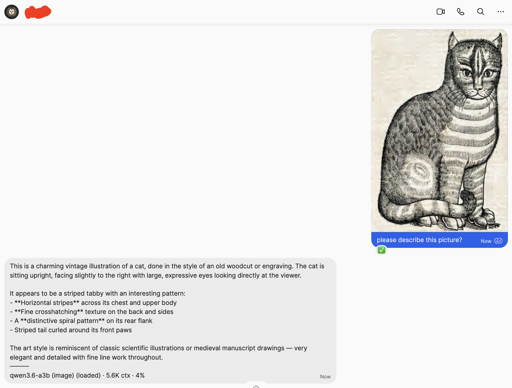

# @gordoneiza/pi-signal

> A fork of [aalzubidy's package](https://github.com/aalzubidy/pi-signal).

Connect [pi](https://pi.dev) to [Signal Messenger](https://signal.org/) for two-way messaging. Send a message from your phone to the Signal account that pi is connected to, and pi receives it, the LLM processes it, and pi replies back automatically. A standalone Signal CLI REST API implementation is used to handle talking to the Signal. 

> **By default, only your own number is allowed.** Note-to-Self messages are always processed; messages from other numbers are only accepted if that number is in `PI_SIGNAL_ALLOWLIST`. Non-allowlisted senders get a 🚫 reaction and a short rejection reply, and sends to them are blocked.

## How It Works

```
Phone → bbernhard/signal-cli-rest-api (Docker, REST + WebSocket) → pi extension
    → 👀 reaction → ⌨️ typing indicator → LLM processes → auto-reply → ✅ reaction
```

The extension talks to the [bbernhard/signal-cli-rest-api](https://github.com/bbernhard/signal-cli-rest-api) container over REST (send, reactions, contacts, health, typing indicator) and a persistent WebSocket on `/v1/receive/{number}` for incoming messages. While the agent is working on a response, the Signal typing indicator ("message is being written…") is shown to the sender and cleared when the reply arrives. signal-cli itself runs inside its own container.

Commands (`/model`, `/abort`, `/clear`, `/stats`, `/status`, `/whoami`, `/resend`, `/pause`, `/resume`, `/help`) are handled locally without LLM. Everything else is forwarded to the LLM.

### Note to Self


### Other numbers
The extension allows communication with other numbers, provided they're in the configured allowed list:



### Image handling
The extension handles attachments by writing to a configured directory (by default `/tmp/pi-signal/attachments`) that are cleaned up after a certain period of time (7 days).



## Installation

> **Note:** Setting up the [bbernhard/signal-cli-rest-api](https://github.com/bbernhard/signal-cli-rest-api) container is **outside the scope of this Pi extension**. This extension assumes a running REST API container and handles only the integration between that container and pi. The container requires an interactive terminal for QR-code device linking, which cannot be fully automated from within pi.

**Prerequisites:** [Docker](https://www.docker.com/) (or Podman), a Signal app on your phone.

### 1. Set up the Signal REST API container

```bash
# Run the signal-cli REST API container
sudo docker run -d --name signal-api --restart unless-stopped \
  -p 127.0.0.1:8090:8080 \
  -v signal-api-data:/root/.local/share/signal-cli \
  bbernhard/signal-cli-rest-api

# Link your Signal account (opens a QR scan — use a real terminal)
sudo docker exec -it signal-api signal-cli -a +1234567890 link
```

### 2. Install the pi package

```bash
pi install @gordoneiza/pi-signal
```

### 3. Configure environment variables

Add these to your shell config (`~/.bashrc`, `~/.zshrc`, …):

```bash
export PI_SIGNAL_ACCOUNT=+1234567890   # your Signal number (E.164)
export PI_SIGNAL_PRIMARY=true          # marks this instance as the one handling Signal
# Optional — numbers allowed to send/receive with the agent (self is always allowed):
# export PI_SIGNAL_ALLOWLIST=+15551234567,+441234567890
# Optional — download media attachments (images, PDFs) to disk:
# export PI_SIGNAL_ATTACHMENTS_DIR=/tmp/pi-signal/attachments  # default
# export PI_SIGNAL_MAX_ATTACHMENT_AGE_DAYS=7                     # default
```

### 4. Start pi and verify

```bash
pi
# /signal-setup  — setup guidance (checks the REST API container is running)
# /signal-status — shows REST API health + WebSocket state
```

Send a Note-to-Self from your phone. pi receives it (👀), processes it, and replies automatically (✅).

**Media attachments:** When you send an image or PDF with text, pi downloads the attachment
and provides the file path to the LLM, which can inspect it using pi's built-in `read` tool.
Attachments are stored in `PI_SIGNAL_ATTACHMENTS_DIR` and auto-cleaned after
`PI_SIGNAL_MAX_ATTACHMENT_AGE_DAYS` days.

## Environment Variables

| Variable | Required | Default | Description |
|---|---|---|---|
| `PI_SIGNAL_ACCOUNT` | Yes | — | Your Signal number in E.164: `+1234567890` |
| `PI_SIGNAL_PRIMARY` | No | `false` | Set `"true"` on the ONE instance handling Signal messages |
| `PI_SIGNAL_DAEMON_URL` | No | `http://127.0.0.1:8090` | Base URL of the bbernhard/signal-cli-rest-api container (REST + WebSocket) |
| `PI_SIGNAL_ALLOWLIST` | No | empty = self only | Comma-separated E.164 numbers allowed to send/receive with the agent. `PI_SIGNAL_ACCOUNT` is always allowed regardless. |
| `PI_SIGNAL_STATS` | No | `short` | Stats mode: `off`, `short`, or `full` |
| `PI_SIGNAL_DEBUG` | No | `false` | Set to `"true"`, `"1"`, or `"log"` to enable verbose debug logging. When on, `createDebug()` output and all `isLoggingEnabled()`-gated `console.error`/`console.warn` calls are emitted. |
| `PI_SIGNAL_ATTACHMENTS_DIR` | No | `/tmp/pi-signal/attachments` | Directory for downloaded media attachments (images, PDFs) |
| `PI_SIGNAL_MAX_ATTACHMENT_AGE_DAYS` | No | `7` | Days before old attachments are auto-deleted |

## Commands (from Signal)

| Command | Purpose |
|---|---|
| `/model <name>` | Switch model (fuzzy match) |
| `/abort` | Stop current generation |
| `/clear` | New session |
| `/stats [short\|full\|off]` | Toggle usage stats |
| `/status` | Live connection & model info (in-memory, never hangs — only answers when pi is up) |
| `/whoami` | Show model, working directory, and session |
| `/resend` | Re-send the last reply (recover a dropped message) |
| `/pause` | Stop processing incoming messages (commands still work) |
| `/resume` | Resume processing |
| `/help` | Show available commands |

> **Send to another number:** just ask the LLM naturally — e.g. *"summarize this and text it to +1555…"*, or by name: *"send this to Mike"*. For a name, the agent resolves it via `signal_list_contacts` first (names only resolve if signal-cli knows them — a synced contact or Signal profile name). The target must be in `PI_SIGNAL_ALLOWLIST`, otherwise the send is blocked. The agent's confirmation reply comes back to your Note-to-Self so you can see who it was sent to.

## TUI Commands (in pi)

`/signal-setup`, `/signal-status`, `/signal-send <+E164> <msg>`, `/signal-model`, `/signal-abort`, `/signal-stats`

## Tools (LLM-accessible)

- **`signal_send`** — Send a Signal message with optional media attachments. `recipient` (E.164) is required; `message` is optional (omit for media-only). Each attachment uses `file` (local path — tool reads & encodes it) or `base64` (data URI / raw base64). Use `view_once: true` for disappearing media. Files capped at 50 MB. Blocked for numbers not in the allowlist.
- **`signal_status`** — Check connection status and health (REST API reachable, WebSocket connected)
- **`signal_list_contacts`** — List contacts (name → number) so the agent can resolve a name before sending

## Multiple Instances

Set `PI_SIGNAL_PRIMARY=true` on one pi instance. Other instances ignore Signal messages.

## Security

- **Default-deny allowlist:** only your own number is allowed by default. Incoming messages from any other number get a 🚫 reaction and a rejection reply; `signal_send` and `/signal-send` refuse to deliver to non-allowlisted numbers. Add trusted numbers via `PI_SIGNAL_ALLOWLIST`.
- **No local message logs:** messages flow over a loopback WebSocket; message content is not written to a log file by pi-signal. (The signal-cli data store inside the container holds conversation data — protect the container volume accordingly.)
- **Unauthenticated REST API on loopback:** the bbernhard container exposes its REST API (default `127.0.0.1:8090`) without an API key by default. It is bound to loopback, but any local process can reach it and could send messages as your account, read contacts, or drive the agent. Run pi-signal only on a **single-trusted-user host** and don't expose the port. (bbernhard optionally supports an API key; this extension does not currently send one.)
- Third-party contact names from `signal_list_contacts` are sanitized before reaching the agent.

## Troubleshooting

```bash
docker ps                                # container running?
docker logs --tail 50 -f signal-api      # container / signal-cli output
curl -s http://127.0.0.1:8090/v1/about   # REST API reachable?
```

- `/signal-status` in pi — shows REST API health and WebSocket state
- `PI_SIGNAL_DEBUG=true` — verbose extension logging (WebSocket frames, parsing, sends, REST requests, attachment downloads)

See [skills/signal/SKILL.md](skills/signal/SKILL.md) for full troubleshooting.

## Files

```
pi-signal/
├── package.json
├── tsconfig.json               # TypeScript config (production)
├── tsconfig.test.json          # TypeScript config (tests)
├── README.md
├── CHANGELOG.md
├── LICENSE
├── extensions/
│   ├── commands.ts             # Command handler registry (/model, /abort, /clear, etc.)
│   ├── signal.ts               # Core logic / WebSocket / agent integration
│   ├── utils.ts                # Shared utilities (phone parsing, fuzzy match, envelope parsing)
│   ├── rest-client.ts          # REST API client for signal-cli container
│   └── attachments.ts          # Attachment download and cleanup
├── skills/
│   └── signal/SKILL.md         # Full setup & troubleshooting guide
└── tests/
    ├── helpers/mocks.ts        # Mock implementations (signal-cli API, WebSocket)
    ├── setup.ts                # Jest global setup
    └── extensions/
        ├── attachments.test.ts
        ├── command-handlers.test.ts
        ├── commands.test.ts
        ├── message.test.ts
        ├── rest-client.test.ts
        ├── signal-integration.test.ts
        └── utils.test.ts
```

## Testing

```bash
npm test              # Run all tests
npm run test:watch    # Watch mode
npm run test:coverage # With coverage report
```

Tests use [Jest](https://jestjs.io/) with [ts-jest](https://www.npmjs.com/package/ts-jest) and [MSW](https://mswjs.io/) for mocking the Signal REST API.

## License

MPL-2.0 — see [LICENSE](LICENSE).
